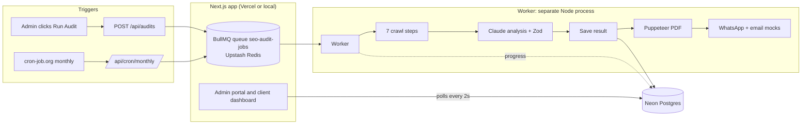

# SEO Automation Dashboard

Automated website SEO audits with AI-powered recommendations, PDF reports and a two-portal interface
(internal **admin** portal + read-only **client** dashboard).

Built for the EdgeLink Technology *AI Developer & Automation Engineer* technical assessment by **Ranjan H. Takawane**.

> **Mock mode works out of the box.** With `USE_MOCKS=true` the full pipeline runs end to end with no external
> API keys except a free Neon (Postgres) database and a free Upstash (Redis) instance.

---

## Contents

1. [What it does](#what-it-does)
2. [Architecture](#architecture)
3. [Tech stack](#tech-stack)
4. [The audit pipeline](#the-audit-pipeline)
5. [Mock strategy and `USE_MOCKS`](#mock-strategy-and-use_mocks)
6. [Getting started](#getting-started)
7. [Environment variables](#environment-variables)
8. [Demo accounts and roles](#demo-accounts-and-roles)
9. [Project structure](#project-structure)
10. [API reference](#api-reference)
11. [Database schema](#database-schema)
12. [Scripts and tests](#scripts-and-tests)
13. [Deployment](#deployment)
14. [Recording the demo video](#recording-the-demo-video)
15. [Assumptions and gaps in the assessment brief](#assumptions-and-gaps-in-the-assessment-brief)
16. [Known limitations](#known-limitations)
17. [Troubleshooting](#troubleshooting)

---

## What it does

- **Admin portal** (`/admin/*`): add clients, click **Run Audit**, watch live progress (a progress bar and a
  step list, polled every 2 s), then read the score cards, issues, recommendations and download the PDF.
- **Client dashboard** (`/dashboard`): a read-only view of the signed-in client's latest audit (score breakdown,
  top issues, quick wins, PDF link) and a score-history chart across previous audits.
- **Audit pipeline**: a BullMQ job crawls the site, collects SEO signals, asks Claude for structured
  recommendations, validates the JSON with Zod, saves it to Postgres, renders a PDF and "sends" it (mocked
  WhatsApp and email).
- **Monthly cron**: `GET /api/cron/monthly` enqueues an audit for every active client (triggered by cron-job.org).
- **Auth**: credentials login with `ADMIN` and `CLIENT` roles, enforced by middleware and again inside every API route.

## Architecture



The web app and the worker are **two separate processes** that talk only through Redis (jobs) and Postgres (state):

- The Next.js app never does the slow work. `POST /api/audits` only creates an `Audit` row (`QUEUED`) and adds a job,
  so it responds in about a second, well inside Vercel's 10 s function limit.
- The worker (`npm run worker`) picks jobs up, runs the pipeline, and writes progress and results to Postgres.
  The portal reads that state.

## Tech stack

| Layer | Technology |
|---|---|
| Frontend + API | Next.js 14 (App Router, JavaScript), Tailwind CSS v4, shadcn/ui, Recharts |
| Queue | BullMQ on Upstash Redis (`ioredis`) |
| Worker | Node.js |
| Crawler | `fetch` + Cheerio (no headless browser) |
| AI | Anthropic Claude (`claude-sonnet-4-6`), responses validated with Zod |
| Database | Neon Postgres via Prisma 6 |
| PDF | Puppeteer |
| Auth | Signed-cookie session (JWT via `jose`), `bcryptjs` password hashes |

## The audit pipeline

Every audit follows this order. Progress is written to the `Audit` row after each step.

| # | Step | Progress after | Source |
|---|---|---|---|
| 1 | Fetch + Cheerio crawl | 9% | Real (never mocked) |
| 2 | PageSpeed Insights | 18% | Mock, real implemented |
| 3 | Google Search Console | 27% | Mock only |
| 4 | Schema.org validation | 36% | Real (parses every `ld+json` block) |
| 5 | On-page analysis | 45% | Real (title, meta, H1/H2, word count, alt coverage, canonical, links, Open Graph) |
| 6 | robots.txt + sitemap.xml check | 55% | Real |
| 7 | DataForSEO rankings | 64% | Mock, real implemented |
| 8 | Claude analysis (+ Zod validation, retry once) | 73% | Mock or real |
| 9 | Save audit result to Postgres | 82% | Real |
| 10 | Generate PDF (Puppeteer) | 91% | Real |
| 11 | WhatsApp + email notification | 100% | Mock (console.log) |

Details worth knowing:

- **Claude output is validated** with a Zod schema: max 5 critical issues, 8 important issues, 5 quick wins, scores
  0 to 100, and fixed enums for priority, category, impact and effort. If the response is not valid JSON or fails
  validation, the worker retries **once** and tells the model exactly what was wrong. A second failure marks the audit `FAILED`.
- **Failure handling**: any step error sets `status = FAILED` and stores the error message.
- **Stale audits**: an audit stuck in `QUEUED`/`RUNNING` for more than 30 minutes (for example the worker was off)
  is expired to `FAILED` the next time an audit is requested for that client, so a client is never blocked forever.
  Only one audit per client can be in flight at once (`409` otherwise).
- **Upstash usage**: the worker uses `drainDelay: 30` and `stalledInterval: 120000` to cut idle Redis commands.
  Stop the worker when you are not using it.

## Mock strategy and `USE_MOCKS`

All mock data lives in `src/mocks/` and the single flag `USE_MOCKS` (read in `src/mocks/index.js`) controls it.
Each crawler follows the pattern from the brief:

```js
const { USE_MOCKS } = require('../mocks');
const mockData = require('../mocks/pagespeed.mock');
async function getPageSpeed(url) {
  if (USE_MOCKS) return mockData;
  // real PageSpeed Insights call
}
```

| Integration | `USE_MOCKS=true` | `USE_MOCKS=false` |
|---|---|---|
| Fetch + Cheerio crawl, schema, on-page, robots/sitemap | Real | Real |
| PageSpeed Insights | Mock data | Real call (set `PAGESPEED_API_KEY` for higher limits) |
| Google Search Console | Mock data | **Not implemented** (throws "not configured") |
| DataForSEO | Mock data | Real call (needs `DATAFORSEO_LOGIN` / `DATAFORSEO_PASSWORD`) |
| Claude analysis | Hand-written mock audit | Real call (needs `ANTHROPIC_API_KEY`) |
| Twilio WhatsApp, email | `console.log` | **Not implemented** (throws "not configured") |
| Reports storage (Cloudflare R2) | Local folder (`REPORTS_DIR`) | Local folder |

**Important:** because one flag controls everything, and Search Console and WhatsApp have no real implementation
(the brief says to mock them completely), `USE_MOCKS=false` makes audits fail at step 3. In practice this project
is run with `USE_MOCKS=true`. See [Known limitations](#known-limitations).

**Mock audits all look the same.** In mock mode the Claude step returns one fixed, hand-written audit
(overall score 64, the same issues for every site). The crawl data underneath is real and differs per site, but the
mock analysis ignores it. Real, site-specific scores need the real Claude call.

## Getting started

### Prerequisites

- Node.js 20+
- A free [Neon](https://neon.tech) Postgres database
- A free [Upstash](https://upstash.com) Redis database
- (Optional) an Anthropic API key, only for real Claude calls

### 1. Install

```bash
npm install            # also runs `prisma generate`
cp .env.example .env   # then fill in the values (see below)
```

### 2. Create the tables and demo users

```bash
npx prisma db push     # creates the tables in Neon
npm run seed           # creates the demo admin, client and demo clinic
```

### 3. Run the app and the worker (two terminals)

```bash
npm run dev            # terminal 1: web app on http://localhost:3000
npm run worker         # terminal 2: the worker that actually runs the audits
```

If an audit stays at **QUEUED / 0%**, the worker is not running.

### 4. Try it

1. Open http://localhost:3000 and sign in as the admin.
2. **Clients**: add a client (or use the seeded *Demo Dental Clinic*) and click **Run Audit**.
3. Watch the progress bar and step list, then open the finished audit and download the PDF.
4. Sign out and sign in as the client to see the client dashboard.

### Run the whole pipeline from a script (no UI)

```bash
node scripts/run-audit.js https://example.com
```

This starts a worker in-process, queues an audit, waits for it to finish and prints the saved database row.

## Environment variables

Copy `.env.example` to `.env`. **Never commit `.env`.**

| Variable | Required | Description |
|---|---|---|
| `DATABASE_URL` | Yes | Neon pooled connection string |
| `DIRECT_URL` | Yes | Neon direct connection string (used by `prisma db push`) |
| `REDIS_URL` | Yes | Upstash `rediss://` URL (TLS) |
| `USE_MOCKS` | Yes | `true` runs everything on mock data (see above) |
| `AUTH_SECRET` | Yes | Secret for signing session cookies (32+ random bytes) |
| `CRON_SECRET` | Yes | Secret header value that protects `/api/cron/monthly` |
| `ANTHROPIC_API_KEY` | Real Claude only | Needed when `USE_MOCKS=false` |
| `CLAUDE_MODEL` | No | Defaults to `claude-sonnet-4-6` |
| `PAGESPEED_API_KEY` | No | Optional, raises PageSpeed rate limits |
| `DATAFORSEO_LOGIN` / `DATAFORSEO_PASSWORD` | Real DataForSEO only | |
| `REPORTS_DIR` | No | Where the worker writes PDFs. Default: `<OS temp dir>/reports` |
| `AUDIT_STEP_DELAY_MS` | No | Pauses after each worker step so the progress bar is watchable (demo only) |
| `DEMO_LOGINS` | No | `true` shows "Admin demo / Client demo" quick-fill buttons on the login page. Keep `false` in production |

Generate secrets with:

```bash
node -e "console.log(require('crypto').randomBytes(32).toString('hex'))"
```

## Demo accounts and roles

Created by `npm run seed`:

| Role | Email | Password | Lands on |
|---|---|---|---|
| ADMIN | `admin@seo-demo.com` | `Admin@12345` | `/admin/clients` |
| CLIENT | `client@seo-demo.com` | `Client@12345` | `/dashboard` (linked to *Demo Dental Clinic*) |

These are **demo passwords**. Change them (or do not seed) for anything public.

There is no sign-up page. To give another client a login:

```bash
node scripts/create-client-user.js <email> <password> "<client name>"
```

### How access works

| Area | ADMIN | CLIENT | Signed out |
|---|---|---|---|
| `/admin/*` | Yes | Redirected to `/dashboard` | Redirected to `/login` |
| `/dashboard` | Redirected to `/admin/clients` | Yes (own data only) | Redirected to `/login` |
| `POST/GET /api/audits`, `/api/clients` | Yes | 403 | 401 |
| `GET /api/audits/[id]` and `/pdf` | Any audit | Own audits only (others return 404) | 401 |
| `GET /api/cron/monthly` | Public to middleware, needs the `x-cron-secret` header | | |

- The session is an HttpOnly, SameSite=Lax cookie holding a signed JWT (7 days).
- A client's identity always comes from the signed cookie, never from the URL.
- Middleware (`src/middleware.js`) is the first gate; every API route re-checks the role and ownership.

## Project structure

The folder structure required by the brief is present exactly (`src/mocks`, `src/crawlers`, `src/queue`,
`src/ai`, `src/reports`, `src/notifications`). Next.js, auth and the UI additionally need `src/app`,
`src/components`, `src/lib`, `src/middleware.js` and a top-level `scripts/` folder.

```
src/
├── mocks/            index.js (USE_MOCKS switch), pagespeed.mock.js, gsc.mock.js,
│                     dataforseo.mock.js, twilio.mock.js
├── crawlers/         pagespeed.js, gsc.js, dataforseo.js, onpage.js, schema.js, technical.js
├── queue/            queue.js (BullMQ queue), worker.js (the pipeline)
├── ai/               claude.js (call + Zod + retry + mock), prompt.js (system and user prompt)
├── reports/          pdf.js (HTML template + Puppeteer)
├── notifications/    whatsapp.js (WhatsApp and email, mocked)
├── lib/              prisma.js, audits.js, auth.js, session.js, steps.js, demo-accounts.js
├── components/       UI components (shadcn/ui in components/ui)
├── middleware.js     route protection by role
└── app/
    ├── login/                    sign-in page
    ├── admin/clients, audits     admin portal
    ├── dashboard/                client dashboard
    └── api/                      auth, audits, clients, cron
prisma/schema.prisma              database schema
scripts/                          seeding, helpers and test scripts
public/images/                    login page background images
```

## API reference

All routes except login, logout and cron require a session cookie.

| Method and path | Who | Description |
|---|---|---|
| `POST /api/auth/login` | Public | `{ email, password }`. Sets the session cookie, returns `{ role, home }` |
| `POST /api/auth/logout` | Anyone | Clears the cookie |
| `POST /api/audits` | Admin | `{ clientId }`. Creates a `QUEUED` audit, enqueues the job, returns **202** `{ id, status }`. `409` if one is already running |
| `GET /api/audits` | Admin | List audits (`?status=`, `?clientId=`). Excludes the large `resultJson` |
| `GET /api/audits/[id]` | Admin, or the owning client | Full audit including progress, `resultJson` and client. Returns `hasPdf`, never the server file path |
| `GET /api/audits/[id]/pdf` | Admin, or the owning client | Streams the PDF |
| `GET /api/clients` | Admin | List clients with their latest audit |
| `POST /api/clients` | Admin | Create a client (`name`, `url`, `businessType`, `city`, `state`). A bare `clinic.com` is normalised to `https://clinic.com` |
| `GET /api/cron/monthly` | Header `x-cron-secret` (or `Authorization: Bearer`) | Enqueues an audit for every active client; skips clients with one in flight |

## Database schema

Defined in `prisma/schema.prisma` (Postgres):

- **User**: `email` (unique), `passwordHash`, `role` (`ADMIN` | `CLIENT`), optional `clientId`
- **Client**: `name`, `url`, `businessType`, `city`, `state`, `active`
- **Audit**: `clientId`, `status` (`QUEUED` | `RUNNING` | `COMPLETED` | `FAILED`), `progress` (0 to 100),
  `currentStep`, `overallScore`, `resultJson` (validated Claude analysis plus raw signals), `pdfPath`, `error`, timestamps
- **Recommendation**: optional table (`priority`, `category`, `finding`, `fix`, `estimatedImpact`, `effort`,
  `falsifiabilityCheck`). The recommendations are stored inside `Audit.resultJson`; this table is not populated yet.

## Scripts and tests

| Command | What it does |
|---|---|
| `npm run dev` / `npm run build` / `npm start` | Next.js app |
| `npm run worker` | Starts the BullMQ worker |
| `npm run seed` | Creates demo admin, client and clinic (safe to re-run) |
| `npm run lint` | ESLint |
| `node scripts/run-audit.js [url]` | Full pipeline from a script (queue to DB to PDF) |
| `node scripts/add-job.js [url]` | Queues one audit (a worker must be running) |
| `node scripts/create-client-user.js <email> <password> "<client>"` | Creates or resets a client login |
| `node scripts/test-crawlers.js [urls]` | Runs the crawlers against real sites |
| `node scripts/test-claude.js` | Tests Zod validation and the retry with a fake model (offline) |
| `node scripts/verify.js` | Checks DB, queue, worker, failure handling, PDF and `USE_MOCKS=false` behaviour |
| `node scripts/test-api.js <baseUrl>` | API route checks (dev server must be running) |
| `node scripts/test-auth.js <baseUrl>` | Auth, roles, ownership, forged tokens and browser login (dev server must be running) |
| `node scripts/test-portal.js <baseUrl> <dir>` | Browser test of the admin portal with live progress (dev server must be running) |
| `node scripts/test-dashboard.js <baseUrl> <dir>` | Browser test of the client dashboard (dev server must be running) |

The `test-*` scripts that need `<baseUrl>` expect `npm run dev` to be running and the demo users to be seeded. They create
temporary data and clean it up, but if a run is interrupted, leftover test clients may remain.

## Deployment

> The recommended split is **Vercel for the web app** and **a separate always-on Node process for the worker**
> (your machine, Render, Railway or Fly). A BullMQ worker cannot run inside Vercel's 10 s serverless functions.

### Web app on Vercel

1. Import the repository in Vercel.
2. Set these environment variables: `DATABASE_URL`, `DIRECT_URL`, `REDIS_URL`, `USE_MOCKS`, `AUTH_SECRET`, `CRON_SECRET`.
   `postinstall` runs `prisma generate` during the build.
3. Run `npx prisma db push` and `npm run seed` once against the production database (from your machine, with `.env` pointing at it).

### Worker

Run `npm run worker` anywhere that can reach Neon and Upstash, with the same `DATABASE_URL`, `REDIS_URL` and `USE_MOCKS`.
Puppeteer needs Chromium: it is downloaded on `npm install`; on a Linux host you may also need Chromium's system libraries.

### Monthly cron (cron-job.org)

1. Create a job that calls `https://<your-app>.vercel.app/api/cron/monthly`.
2. Schedule it **monthly** (for example the 1st at 02:00).
3. Add the header `x-cron-secret` with the value of `CRON_SECRET`.
4. Use **Test run**: a `200` with `{ "clients": n, "queued": n, ... }` means it works; `401` means the secret does not match.

Do **not** schedule it every minute: each call queues an audit for every active client.
Audits queued by cron only run while the worker is running.

## Recording the demo video

Order requested by the brief: job queued in BullMQ, progress updating in the portal, Claude returning JSON,
audit saved in Postgres, PDF generated.

1. Start the app (`npm run dev`) and the worker with `AUDIT_STEP_DELAY_MS=1500 npm run worker` (PowerShell:
   `$env:AUDIT_STEP_DELAY_MS=1500; npm run worker`) so each step stays on screen long enough.
2. Sign in as admin, click **Run Audit**, and show the job in the Upstash data browser (the `bull:seo-audit-jobs:*` keys).
3. Show the progress bar and step list updating on the audit page.
4. Show the worker terminal (the Claude step runs here).
5. Show the new row in the Neon console (`Audit` table, with `resultJson`).
6. Open the generated PDF from the audit page.

## Assumptions and gaps in the assessment brief

These were found while implementing and are stated here as the brief requires.

1. **Section 5 (Prisma schema) and Section 6 (audit API route) are missing from the brief.** I designed both
   (see [Database schema](#database-schema) and [API reference](#api-reference)).
2. **Hosting contradiction.** The brief lists backend workers on both "VPS" and "Vercel (serverless functions + cron)".
   A BullMQ worker cannot run on Vercel's 10 s functions, so the app runs on Vercel and the worker is a separate process.
3. **Cron wording.** The brief suggests cron-job.org triggering "the audit worker API route every minute". There is no
   serverless worker route here, so cron-job.org calls a route that only *enqueues* monthly audits.
4. **Mock domain mismatch.** The mock data uses `example-dental-clinic.com` (PageSpeed) and `exampledental-clinic.com`
   (DataForSEO, as extracted from the PDF text). Client rank is therefore never matched by domain string.
5. **"REAL/MOCK" for Claude is ambiguous.** I built a real call plus a mock fallback behind the flag.
6. **Reports storage.** Cloudflare R2 is mocked by a local folder (`/tmp/reports` equivalent, `REPORTS_DIR`).
7. **Mock files** were copied from the brief; only whitespace was reformatted.
8. **Email subject** for submission follows the brief: `Technical Assessment — AI Developer — <Full Name>`.

## Known limitations

- **`USE_MOCKS=false` is not runnable end to end.** One flag controls every integration, and Google Search Console and
  Twilio/email have no real implementation, so audits fail at step 3. A separate flag that makes only Claude real would fix this.
- **The real Claude call and the real PageSpeed call have not been tested** (no API key was used). The validation and
  retry logic is tested offline with a fake model.
- **Mock audits all score 64.** See [Mock strategy](#mock-strategy-and-use_mocks).
- **PDFs live on the worker's disk.** The web app serves them by reading `Audit.pdfPath`, so the PDF download only works
  when the app and the worker share a filesystem (local development). On a Vercel deployment the file is on another
  machine. Storing the PDF bytes in Postgres would fix this.
- **Cheerio does not run JavaScript**, so sites that render their content in the browser (single-page apps) crawl as nearly empty.
- **No sign-up page, and no edit or delete for clients.** Logins come from `npm run seed` or `scripts/create-client-user.js`.
- **No rate limiting or lockout on login**, and sessions cannot be revoked before they expire (7 days).
- **Demo passwords are weak by design.** Change them for any public deployment.
- The `Recommendation` table is defined but not populated; recommendations live in `Audit.resultJson`.

## Troubleshooting

| Symptom | Cause and fix |
|---|---|
| Audit stays **QUEUED / 0%** | The worker is not running. Start `npm run worker` |
| Audit **FAILED: fetch failed** | The client's website URL does not exist or is unreachable. Check the URL |
| Audit **FAILED: ... not configured** | `USE_MOCKS=false` with an integration that has no real implementation. Set `USE_MOCKS=true` |
| Random 404s on pages and assets in dev | Two `next dev` servers are running in the same folder and share `.next`. Stop one |
| `prisma db push` fails | Check `DIRECT_URL` (use the non-pooled Neon string) |
| Login says "Invalid email or password" | Run `npm run seed`, or check you are using the demo credentials above |
| Cron test returns 401 | The `x-cron-secret` header does not equal `CRON_SECRET` |
